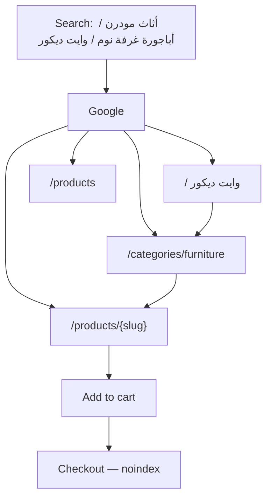
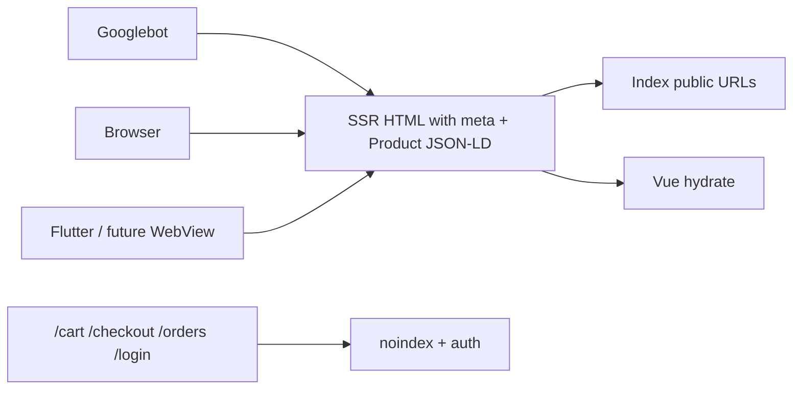
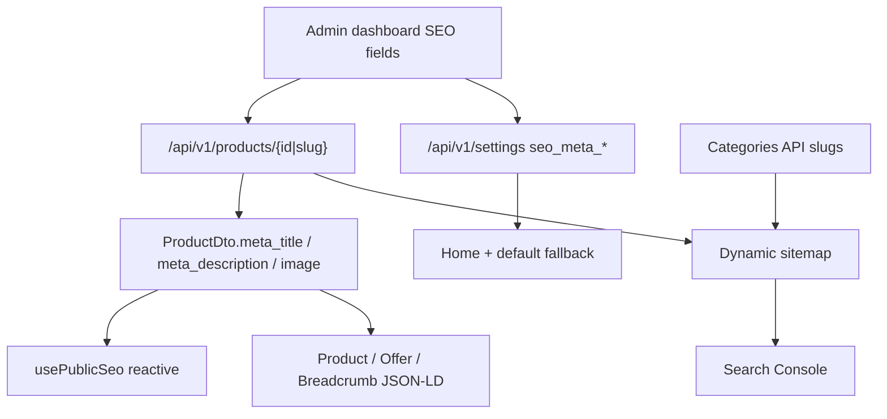

# وايت ديكور — SEO, Sitemap & Search Plan

**Status:** implemented (27 Aug 2026). Locked to recommended answers. Live canonical after DNS: `https://whitedecor.online`.

**Locked answers**

| Q | Choice |
|---|---|
| Q1 domain | **A** `https://whitedecor.online` |
| Q2 HTML to Google | **A** Await catalog on the server (no `lazy` on public pages) |
| Q3 NAP / brand identity | **A** Keep Egypt phone/WhatsApp; replace email/address in dashboard when ready |
| Q4 market | **A** Egypt / EGP / `ar_EG` + `en_EG` |
| Q5 off-site accounts | Search Console + sitemap now; Merchant Center later |
| Q6 human sitemap | **A** XML **and** bilingual `/sitemap` |
| Q7 product URLs | **A** `/products/{slug}` + 301 from numeric id |
| Q8 locale URLs | **A** `prefix_except_default` — Arabic `/…`, English `/en/…` + hreflang |

**Live evidence (tested this session)**

| Surface | Result |
|---|---|
| `https://whitedecor.online/` | **Namecheap parking page.** Not the Nuxt app. No sitemap, no robots, no store HTML. |
| `https://www.whitedecor.online/` | SSL hostname mismatch |
| `https://dashboard.whitedecor.online/api/v1/*` | **Live.** Products, categories, settings (including SEO keys) all respond |

**What you still do (code is done; this is ops)**

1. **DNS + SSL** — Point `whitedecor.online` and `www` at the Nuxt host. Today the domain is still a [Namecheap parking page](https://whitedecor.online). Nothing ranks until this changes.
2. **Deploy backend** — Product `slug` in the API, brand `name`/`image`/`slug`, 404 (not 500) on missing products. Run the brand slug migration.
3. **Deploy Nuxt** — With `NUXT_PUBLIC_SITE_URL=https://whitedecor.online`. Optional: `NUXT_PUBLIC_GOOGLE_SITE_VERIFICATION`.
4. **Dashboard copy** — Replace seed SEO (`متجر إلكتروني` / `Ecommerce Store`), real public email (not `eslam@gmail.com`), Instagram/Facebook if you have them, real furniture products (catalog is still faker).
5. **Google Search Console** — Add `https://whitedecor.online` → verify → submit `https://whitedecor.online/sitemap.xml`. Same sitemap in Bing. Merchant Center later.

**Search Console steps**

1. Open [Google Search Console](https://search.google.com/search-console) → add property `https://whitedecor.online`
2. Verification: paste token into `NUXT_PUBLIC_GOOGLE_SITE_VERIFICATION` **or** drop Google’s `google*.html` into `website/public/`
3. Sitemaps → submit `https://whitedecor.online/sitemap.xml`
4. Same sitemap in Bing Webmaster
5. Optional but high-value for this shop: Google Merchant Center (product listings)

---

**Scope:** public catalog + marketing pages only.

**Must rank:** `/`, `/products`, `/products/{slug}`, `/categories`, `/categories/{slug}`, `/brands`, `/about`, `/search` (canonicalized), `/sitemap`, `/privacy`, `/terms`.

**Must never rank:** `/login`, `/register`, `/forgot-password`, `/otp`, `/cart`, `/checkout`, `/orders/**`, `/profile/**`, `/maintenance`.

---

## Current state (investigation)

What Google and a browser actually see **today**:

| Item | Status |
|---|---|
| Production domain | **Critical.** `whitedecor.online` is a parking page. Canonical / sitemap / Search Console cannot work until DNS points at the Nuxt host. |
| Nuxt `ssr: true` | Good on paper. Public catalog pages then fetch with `{ lazy: true }`, so the **first HTML Google gets is a skeleton**, not the product H1 / price / description. |
| `useSeo()` | Exists, but is **not reactive**. Product page calls it once while `product` is still `null` → title becomes `Product Details \| White Decor`. |
| Backend product SEO | **Already sent.** `meta_title`, `meta_description`, `meta_keywords` are on every product (list + detail). The Nuxt `ProductDto` **does not declare them**, and pages never read them. |
| Store-level SEO settings | Backend `/api/v1/settings` returns `seo_meta_title_ar/en`, `seo_meta_description_*`, `seo_meta_keywords_*`. Website `useSettingsStore` **ignores them**. Live values are still seed placeholders: `متجر إلكتروني` / `Ecommerce Store`. |
| Product `slug` | Model + `findByIdentifier()` exist. `ProductResource` **does not emit `slug`**. Website links `/products/{id}`. Slug lookup returned **HTTP 500** in live tests. |
| XML sitemap | Code has `@nuxtjs/sitemap` + `server/api/__sitemap__/urls.ts`, but that source lists **only 5 static URLs** (home, about, terms, privacy, categories). **No products. No category slugs. No brands.** Live domain 404s this file. |
| `robots.txt` | Coded in `server/routes/robots.txt.ts`. Live domain 404s. Missing `/checkout` and `/search?*` rules. Footer currently links `/orders` (private). |
| Favicon / Apple icon / OG cover | **Missing from `website/public/`.** Only flag SVGs exist. Code points at `/images/logo.png`, `/images/og-brand-cover.jpg`, `/images/placeholder.webp` — those files are not in the repo. Settings `fav_icon` is the filename `fav_icon.png` (not a full URL). |
| Open Graph / Twitter / WhatsApp cards | Partial. Default OG image 404s. No `og:image:width/height`, no locale alternate, no `og:site_name` from settings. |
| JSON-LD | Thin. Home Organization uses hardcoded Instagram/Facebook (social constants are empty). Product schema has no `url`, `brand`, `aggregateRating`, `priceValidUntil`, or `seller`. No `BreadcrumbList` on product/category. No `ItemList` on listings. No `SearchAction`. |
| `hreflang` | Missing. i18n `strategy: 'no_prefix'` means AR and EN share one URL. |
| Title duplication | `nuxt.config` `titleTemplate: '%s \| White Decor'` **plus** `useSeo` already appends `\| app_name` **plus** `useAppSettings` sets another template. Risk: `Name \| White Decor \| White Decor`. |
| Brand API | 15 brands live, but `BrandResource` omits `name`, `image`, `slug`. Brand pages cannot be unique landing pages yet. |
| Category SEO | Categories have `slug` + `name` + `image`. **No** `description` / `meta_*`. Website type allows `description` that the API never sends. |
| Catalog quality | Live catalog is **faker seed** (100 products, names like `aut iusto aut`, categories Electronics / Fashion). SEO copy in this plan is the **target** once real furniture data is in the dashboard. |
| Settings leak | Public settings payload includes maps/firebase keys. Must not be copied into prerendered HTML. |
| Viewport / a11y | Fine (`initial-scale=1`, no `maximum-scale=1`). Keep it. |

### Live API payloads we will consume (already exist)

**`GET /api/v1/settings`** (locale via `accept-language`)

- Brand: `name_ar` = `وايت ديكور`, `name_en` = `white decor`
- Contact: `phone` / `whatsapp` = `+201000933972`, `email` = `eslam@gmail.com` (placeholder)
- Logos: full CDN URLs on `logo_ar` / `logo_en`
- SEO keys present but **generic placeholders** — replace in dashboard before launch:
  - `seo_meta_title_ar` = `متجر إلكتروني`
  - `seo_meta_description_ar` = `أفضل متجر إلكتروني`
  - matching EN keys equally generic

**`GET /api/v1/products` and `GET /api/v1/products/{id}`**

- `total`: 100
- Fields Google needs: `id`, `name`, `sku`, `price`, `final_price`, `in_stock`, `image`, `gallery`, `short_description`, `description`, `meta_title`, `meta_description`, `meta_keywords`, `category.slug`, `category.name`
- **Missing in JSON:** `slug` (exists in DB)

**`GET /api/v1/categories?roots=1&embed=children`**

```
electronics          إلكترونيات
  phones / laptops / accessories
fashion              أزياء
  men / women / kids
home-garden          المنزل والحديقة
  furniture / kitchen / decor
sports               رياضة
  fitness / outdoor
```

**`GET /api/v1/brands`** — IDs only until `BrandResource` is fixed.

### Public URL map today (Nuxt)

```
/                          home                 ← index
/products                  catalog              ← index
/products/:id              product (numeric)    ← index, but empty first HTML
/categories                category index       ← index
/categories/:slug          category grid        ← index, lazy
/brands                    brands directory     ← index, incomplete API
/search                    on-site search       ← index (should canonicalize)
/about /privacy /terms     legal                ← index
/sitemap                   MISSING
/login /register /otp /forgot-password          ← noindex in useSeo, not all in robots
/cart /checkout /orders/** /profile             ← noindex in useSeo; checkout missing from robots
/maintenance                                    ← noindex
```

---

## 1. Questions & Clarifications

### Q1 — Production domain (required for canonical, sitemap, Search Console)

- **A (recommended):** `https://whitedecor.online` — you already own it; `nuxt.config` and `useSeo` already assume this. **You must point DNS A/CNAME off Namecheap parking onto the Nuxt host.** Also add `www` → apex redirect + valid SSL for both.
- **B:** Keep the shop on another host and treat `whitedecor.online` as later. Paste the real URL: `________________`
- **C:** Another domain you will paste here: `________________`

Without Q1, every canonical tag and `sitemap.xml` is wrong.

### Q2 — How HTML is served to Google

This site is SSR (`ssr: true`), unlike وثاق’s Firebase SPA. The bug is **lazy catalog fetches**, not missing SSR.

- **A (recommended): Blocking SSR for public catalog.** Home, product, category, products index, about/legal await `useAsyncData` (drop `lazy: true`). Private routes stay `ssr: false` (already in `routeRules`).
- **B:** Hybrid prerender of home + category + top products (`nuxt generate` / `nitro.prerender.routes` from the API). Needs a rebuild/cron when catalog changes. Use if the host is static-only.
- **C:** Keep `{ lazy: true }`. **Weak** — Google sees skeletons. Sitemap/meta become decoration.

### Q3 — Business data shown to Google (NAP)

Google needs **one** name + phone + city + email everywhere (footer, about, schema, Search Console).

Live today: name `وايت ديكور` / `white decor`, phone `+201000933972` (Egypt), email `eslam@gmail.com`, social links empty, no street address.

- **A:** Keep current phone/WhatsApp; you send the **real** public email, city, and (optional) street later.
- **B (recommended when ready):** You send the real: legal name, CR/tax id, street, district, city, phone, WhatsApp, email, working hours, Instagram, Facebook, TikTok.

### Q4 — Target market for search

Schema currently hardcodes `priceCurrency: 'EGP'` and `og:locale: ar_EG`. Phone is `+20`.

- **A (recommended v1):** Egypt only (`areaServed` = EG, currency EGP, locale `ar_EG` / `en_EG`).
- **B:** Egypt + GCC (each extra country needs honest shipping copy — do not fake warehouses).
- **C:** Saudi / other — you will say which, and we change currency + locale + phone.

### Q5 — Off-site accounts (you do these; I prepare the files)

- Google Search Console — `robots.txt` + HTML/DNS file
- Bing Webmaster (same sitemap)
- Google Business Profile «وايت ديكور» in the Q4 city
- Google Merchant Center (product feed) — optional wave 5
- Optional: GA4 linked to Search Console

Confirm you can log in, or skip for this wave.

### Q6 — Human sitemap page

- **A (recommended):** XML sitemap for Google **and** a bilingual page `/sitemap` linked from the footer (desktop) and the drawer (mobile). Same pattern as وثاق.
- **B:** XML only.

### Q7 — Product URL shape

Backend already supports `GET /api/v1/products/{id|slug}`. Website uses numeric IDs.

- **A (recommended):** `/products/{slug}` with 301 from `/products/{id}`. Needs `slug` in `ProductResource` + fix the live 500 on slug show.
- **B:** Keep `/products/{id}` and only add slug as a later redirect.

### Q8 — Arabic / English URLs

وثاق was Arabic-only. MailStorm used locale prefixes. This shop is bilingual with `strategy: 'no_prefix'` (one URL, cookie locale).

- **A (recommended for search):** `prefix_except_default` — Arabic at `/products/lamp`, English at `/en/products/lamp`, plus `hreflang` + `x-default`.
- **B:** Stay `no_prefix` (simpler UX, weaker bilingual SEO; one locale “wins” the URL).

---

## 2. Logic Flow

### 2.1 What an Egyptian searcher should hit



### 2.2 Crawler vs human vs app



### 2.3 Meta pipeline (backend is source of truth)



Fallback order per page (never leave empty title/description):

1. Entity `meta_title` / `meta_description` from API (current locale)
2. Else entity `name` + `short_description` (stripped, ≤ 160 chars)
3. Else settings `seo_meta_*` for that locale
4. Else i18n `home_seo_title` / `home_seo_desc`

### 2.4 Sitemap generate pipeline

1. Nitro handler `server/api/__sitemap__/urls.ts` (or a dedicated `server/routes/sitemap.xml.ts` like وثاق if we drop the module) fetches:
   - static public paths
   - all category slugs (roots + children)
   - all active product slugs (paginated until `meta.last_page`)
   - brands **only after** BrandResource exposes slug
2. Emits `sitemap.xml` (or sitemap index if product count grows past ~10k).
3. `robots.txt` points at that file on the **approved Q1 domain**.
4. Staging hosts: `Disallow: /` (MailStorm pattern) so preview never ranks.

### 2.5 Per public page SEO payload

Every public page sets:

- Unique `<title>` (≈ 50–60 chars, locale-correct, brand at end **once**)
- Unique `description` (≈ 140–160 chars)
- Canonical `https://{domain}{path}` (no query string except pagination if we keep `?page=`)
- `og:*` + `twitter:card` + 1200×630 image
- JSON-LD
- `lang` + `dir` (already in `app.vue`)
- `hreflang` if Q8-A

Private pages: `robots: noindex, nofollow`.

---

## 3. UI Kit (Text View & Mockups)

SEO is mostly head tags, but four visible surfaces change.

### 3.1 Browser tab (favicon)

```
+--------------------------------------------------+
| [شعار وايت ديكور 32px]  أباجورة نحاس | وايت ديكور |
+--------------------------------------------------+
```

Assets to generate from the dashboard logo (`logo_ar` URL already live):

- `favicon.ico` (16 + 32)
- `favicon-32x32.png`, `favicon-16x16.png`
- `apple-touch-icon.png` (180×180)
- `icon-192.png`, `icon-512.png`
- `og-cover.png` **and** `og-cover-ar.png` (1200×630) — navy field, gold mark, one Arabic line / one English line (MailStorm split OG)
- `site.webmanifest` — `name: وايت ديكور`, `lang: ar`, `theme_color` navy

### 3.2 WhatsApp / X share preview

```
+------------------------------------------+
| ##########  og-cover-ar.png              |
| #  [شعار]  وايت ديكور                    |
| #  أثاث وديكور منزلي فاخر                |
+------------------------------------------+
| أباجورة نحاس لغرفة النوم | وايت ديكور    |
| إضاءة هادئة بخامة معدنية...              |
| whitedecor.online                        |
+------------------------------------------+
```

Arabic OG strings (v1 examples — rewrite when real catalog exists):

| Page | og:title | og:description |
|---|---|---|
| Home | وايت ديكور — أثاث وديكور منزلي في مصر | تسوّق إضاءة وأثاث وقطع ديكور عصرية مع توصيل داخل مصر. |
| Products | تسوق الأثاث والإضاءة | وايت ديكور | كل التشكيلة: وصل حديثاً، عروض، والأكثر مبيعاً. |
| Category furniture | أثاث منزلي عصري | وايت ديكور | كنبات، طاولات، وقطع معيشة مختارة لغرف البيت. |
| Product | `{meta_title from API}` | `{meta_description from API}` |
| Contact-less about | عن وايت ديكور | قصتنا واختيار القطع الهادئة للمنازل العصرية. |

### 3.3 HTML sitemap `/sitemap`

```
+--------------------------------------------------+
|  وايت ديكور                                      |
|  خريطة الموقع                                    |
|  كل الصفحات العامة في مكان واحد.                 |
|                                                  |
|  الرئيسية                                        |
|  تسوق                                            |
|    • كل المنتجات                                 |
|    • التصنيفات                                   |
|        • المنزل والحديقة                         |
|            • أثاث / مطبخ / ديكور                 |
|        • ...                                     |
|    • الماركات                                    |
|  من نحن / الخصوصية / الشروط                      |
+--------------------------------------------------+
```

Copy:

- H1: `خريطة الموقع` / `Sitemap`
- Intro: `روابط وايت ديكور العامة: التصنيفات، المنتجات، والسياسات.`
- Do **not** list cart, checkout, orders, login, profile.

Desktop: grouped columns inside `max-w-7xl`. Mobile: stacked lists. Footer + drawer gain `خريطة الموقع`.

### 3.4 Category / product FAQ (SEO + trust)

Native `<details>` / `<summary>` on category + PDP (crawlers read answers; no JS accordion).

```
| الأسئلة الشائعة                          |
| هل التوصيل متاح داخل مصر؟               |
|   ▼ نعم، نوصّل للعنوان المسجّل عند الطلب. |
| هل القطعة أصلية كما في الصور؟            |
|   ▼ نعم. الصور من التشكيلة الفعلية.      |
```

### Design tokens

- Colors: `--color-navy`, `--color-gold`, `--color-surface`, `--color-mist` (existing)
- Desktop: `max-w-7xl`, Cairo (AR) / Outfit (EN)
- Favicon background: navy or white so the mark reads at 16px
- Do not invent new hex in templates

---

## 4. Recommended Animations

Keep motion tiny. Indexable HTML must not wait on splash / JS-only accordions.

1. Sitemap links: existing hover underline (desktop only).
2. FAQ: native `<details>` / `<summary>` — **no extra JS**.
3. Keep current product-card hover lift.
4. **Do not** let `AppSplashOverlay` delay first paint of public HTML. Splash stays `ClientOnly` and must not replace SSR product content.
5. **Do not** add page-load splash or delayed content injection on public catalog HTML.

**Approve these before implementation.**

---

## 5. Product Strength Recommendations

1. **Point `whitedecor.online` at the Nuxt host (Q1-A)** — without this, Google indexes a parking page.
2. **Await catalog on the server (Q2-A)** — the single biggest ranking unlock *inside the app*. Lazy fetch is why PDP meta is empty.
3. **Use the meta the backend already sends** — do not invent a second SEO CMS in Nuxt. Admin fills `meta_title` / `meta_description` / `meta_keywords` per product (AR+EN). Settings fill store-wide defaults.
4. **Slug URLs (Q7-A)** — `/products/brass-table-lamp` ranks; `/products/91` does not.
5. **Dynamic XML sitemap from the same APIs** — 100 products × 11 category URLs today; grows automatically.
6. **`noindex` the commerce shell** — cart/checkout/orders/login must never outrank a product.
7. **Organization + Product + Offer + BreadcrumbList + ItemList JSON-LD** — Merchant-style rich results need price, currency, availability, image, sku.
8. **Fix BrandResource** — name + image + slug, or `/brands` is a dead ranking URL.
9. **Replace seed SEO settings** in the dashboard (`متجر إلكتروني` → real White Decor copy) before Search Console submit.
10. **NAP lock** — one name `وايت ديكور`, one Egypt phone, one email, same in footer + about + schema + Google Business.
11. **Search Console + Merchant Center** after first real deploy.
12. **Real catalog content** — faker Latin names will not rank for «أثاث». SEO engineering cannot replace product copy.

Not in this wave: paid ads, fake city landing pages, English-only domain, rewriting the whole Flutter app, exposing maps/firebase keys in HTML.

---

## 6. File & Folder Architecture

Follow `.agents/skills/nuxt_code_standards/SKILL.md`: `<script setup lang="ts">`, Pinia setup stores, SFCs **< 120 lines**, `$t()` only, CSS variables, `useApi()`, SSR-safe, `onUnmounted` cleanup.

### Files to Create [NEW]

| Path | Responsibility |
|---|---|
| `website/app/composables/usePublicSeo.ts` | Reactive `useSeoMeta` + canonical + OG + Twitter + robots (وثاق `usePublicSeo` + MailStorm extras: image size, `max-image-preview`) |
| `website/app/composables/useJsonLd.ts` | `@graph` builder: Organization, WebSite+SearchAction, WebPage, BreadcrumbList, Product+Offer, ItemList, FAQPage |
| `website/app/composables/useCatalogSeo.ts` | Maps API `meta_*` → title/description/keywords/image with the fallback chain in §2.3 |
| `website/app/data/seo.ts` | `SITE_URL`, default descriptions, static route copy (about/privacy/terms/sitemap), keyword map, FAQ strings |
| `website/app/pages/sitemap.vue` | Bilingual HTML sitemap (categories tree + legal). Thin page. |
| `website/app/components/seo/SeoFaqList.vue` | Native `<details>` list (< 120 lines) |
| `website/public/favicon.ico` | Tab icon |
| `website/public/favicon-32x32.png` | High-DPI tab |
| `website/public/apple-touch-icon.png` | iOS / Safari |
| `website/public/icon-192.png` / `icon-512.png` | Android / PWA |
| `website/public/og-cover.png` / `og-cover-ar.png` | Share images 1200×630 |
| `website/public/site.webmanifest` | `name: وايت ديكور`, icons, theme color |
| `website/server/middleware/trailing-slash.ts` *(optional)* | One canonical host + slash policy |

Sitemap/robots: keep `@nuxtjs/sitemap` **and** add `@nuxtjs/robots` **or** keep the custom `robots.txt.ts` (MailStorm-style production gate). Prefer one source of truth.

### Backend files to Create / tighten [NEW or small PATCH]

| Path | Responsibility |
|---|---|
| `backend/app/Http/Resources/ProductResource.php` | Add `slug` to **micro** (needed for cards, sitemap, PDP links) |
| `backend/app/Http/Resources/BrandResource.php` | Add `name`, `slug` (generate if missing), `image` |
| `backend/app/Services/ProductService.php` + repository | Fix slug `show` 500; 404 when slug missing, never 500 |
| Optional `GET /api/v1/sitemap` | Lightweight `{ products: [{slug,updated_at}], categories: [{slug,updated_at}] }` so Nitro does not paginate 50 product pages. If skipped, Nuxt paginates `limit=100` until last page. |

Category `meta_*` columns are **not** required for v1. Generate title/description from `name` + settings until the dashboard grows category SEO fields.

### Files to Modify [MODIFY]

| Path | Changes |
|---|---|
| `website/nuxt.config.ts` | Single `titleTemplate`; `site.url` from Q1; routeRules: public SSR, private `ssr: false` + `robots: noindex`; head: favicon set, manifest, theme-color, optional `google-site-verification`; i18n strategy if Q8-A; sitemap sources stay API-driven |
| `website/server/api/__sitemap__/urls.ts` | Fetch categories + products (+ brands when ready). Exclude private paths. `lastmod` from `updated_at`. |
| `website/server/routes/robots.txt.ts` | Production vs staging (MailStorm). `Disallow` login/register/otp/forgot-password/cart/checkout/orders/profile. `Allow: /`. `Sitemap: {Q1}/sitemap.xml`. |
| `website/app/composables/useSeo.ts` | Either replace with `usePublicSeo` or make options `MaybeRef` + computed. Stop double-suffixing the brand. |
| `website/app/composables/useSchemaOrg.ts` | Delegate to `useJsonLd` `@graph` with stable `@id`s (`/#organization`, `/#website`) like MailStorm |
| `website/app/composables/useAppSettings.ts` | Parse `seo_meta_*`; do **not** inject maps/firebase into head |
| `website/app/stores/settings.ts` | Map `seo_meta_title_ar/en` etc. Public allow-list of keys (no secrets) |
| `website/app/types/product.ts` | `slug`, `meta_title`, `meta_description`, `meta_keywords` |
| `website/app/types/brand.ts` | `slug`, `name`, `image` |
| `website/app/types/settings.ts` | SEO fields |
| `website/app/pages/products/[id].vue` | Rename to `[slug].vue` if Q7-A; **await** `useAsyncData` (no lazy); `useCatalogSeo(product)` + Product JSON-LD + BreadcrumbList. Split if still > 120 lines. |
| `website/app/pages/categories/[slug].vue` | Await data; CollectionPage + ItemList; FAQ |
| `website/app/pages/products/index.vue` | Await; CollectionPage + ItemList; canonical without noisy filters |
| `website/app/pages/index.vue` / `useHomeData.ts` | Home SEO from settings `seo_meta_*`; WebSite SearchAction |
| `website/app/pages/search.vue` | `noindex` **or** index only when `q` has results + canonical `/search?q=` |
| `website/app/pages/about/index.vue` `privacy` `terms` | Unique descriptions from `data/seo.ts`; strip HTML from settings for meta |
| `website/app/pages/login.vue` and auth/cart/checkout/orders/profile | Keep `noIndex`; add `robots` routeRules |
| `website/app/components/products/ProductCard.vue` | Link `/products/${product.slug \|\| product.id}`; `alt` = name; `NuxtImg` already used |
| `website/app/components/layout/UiAppFooter.vue` | Add sitemap link; **remove** `/orders` from public footer (it is private) |
| `website/app/components/layout/DrawerNavLinks.vue` | Add `خريطة الموقع`; do not expose orders to guests |
| `website/app/constants/social.ts` | Fill real profile URLs for `sameAs` (or load from settings) |
| `website/i18n/locales/ar.json` + `en.json` | Sitemap strings, FAQ, richer `home_seo_*`, category SEO templates |
| `website/app/app.vue` | Do not refetch in a way that blanks SSR head |

### Files to Delete [DELETE]

None as source. Stale parking-page DNS is an ops change, not a git delete. Generated `.nuxt` / `.output` stay out of git.

---

## 7. Testing Strategy

1. **`curl` SSR HTML** — `/`, `/products/{slug}`, `/categories/furniture` must contain Arabic (or EN) H1, meta description, and Product/ItemList JSON-LD **before** any JS. No `Product Details` fallback.
2. **Favicon** — tab shows White Decor mark (Chrome + Safari), not the default globe / Namecheap icon.
3. **`/sitemap.xml`** — lists home + legal + every category slug + every active product slug on the Q1 domain. No `/cart`, `/login`, `/orders`.
4. **`/robots.txt`** — `Allow: /`, private `Disallow`, `Sitemap: https://{domain}/sitemap.xml`. Staging `Disallow: /`.
5. **API contract** — `GET /api/v1/products/{slug}` returns 200 with `slug` + `meta_title`. Numeric URL 301s. Unknown slug 404 + `noindex`.
6. **Lighthouse SEO** on home + one category + one PDP (desktop + 390px).
7. **Rich Results Test** on home Organization and one Product.
8. **WhatsApp share** of home and one PDP — preview image + Arabic title.
9. **Locale** — if Q8-A, `hreflang` pair + English `/en/...` source HTML is English.
10. **Regression** — add to cart, checkout, RTL drawer, splash once-per-session, language switch still refreshes names without wiping meta into duplicates.
11. **Secrets** — view-source of `/` must not contain maps/firebase keys.

Cannot fully verify without Q1 DNS + Search Console: live indexing, Merchant listings, local pack.

---

## 8. Coding Standards Compliance

- Follow `.agents/skills/nuxt_code_standards/SKILL.md`.
- Public copy bilingual via i18n. Brand **وايت ديكور** / **White Decor**. Never «Namecheap», faker Latin, or dashboard secrets on indexed pages.
- Thin pages; SEO helpers in composables + `data/seo.ts`.
- Backend remains the CMS for product meta. Nuxt only maps and falls back.
- Private HTML must not leak PII (orders).
- Currency / locale / `areaServed` follow Q4 (default EG / EGP / `ar_EG`).

---

## Implementation waves (after approval)

**Wave 0 — Backend contract (unblocks everything)**  
Expose product `slug`; fix slug show 500; BrandResource `name` + `image` + `slug`; optional sitemap lite endpoint; confirm settings `seo_meta_*` (you replace placeholder copy in admin).

**Wave 1 — Identity**  
Favicon set, manifest, OG covers, single title template, consume settings SEO + product `meta_*` in types/composables.

**Wave 2 — Crawl**  
Await SSR on public catalog; robots (production gate); dynamic XML sitemap; HTML `/sitemap`; footer/drawer links; `noindex` routeRules; strip `/orders` from public footer.

**Wave 3 — URLs & schema**  
Slug PDPs + 301 from id (if Q7-A); `hreflang` if Q8-A; `@graph` JSON-LD; category ItemList; FAQ `<details>`; SearchAction on WebSite.

**Wave 4 — Verify**  
`curl` HTML, Lighthouse, Rich Results, WhatsApp share, staging robots. Hand you Search Console + Merchant Center checklist.

**Wave 5 — After real catalog (ops)**  
You: DNS for Q1, Search Console verify, submit sitemap, Google Business, replace faker products with real furniture copy. Optional Merchant feed.

---

## Recommended keyword map (v1, مصر — rewrite when catalog is real)

| Intent | Target URL |
|---|---|
| وايت ديكور / أثاث مودرن مصر / ديكور منزلي | `/` |
| تسوق أثاث وإضاءة | `/products` |
| عروض / خصومات | `/products?offers=true` (canonical to a dedicated path later if it ranks) |
| تصنيفات | `/categories` |
| أثاث | `/categories/furniture` |
| ديكور | `/categories/decor` |
| مطبخ | `/categories/kitchen` |
| المنزل والحديقة | `/categories/home-garden` |
| إضاءة / أباجورات *(when that category exists)* | `/categories/{slug}` |
| ماركات | `/brands` then `/brands/{slug}` after Wave 0 |
| منتج | `/products/{slug}` ← `meta_title` from API |
| بحث داخلي | `/search?q=` (noindex or tightly canonicalized) |
| من نحن | `/about` |
| تواصل واتساب | footer / schema `ContactPoint` (no extra page unless you want `/contact`) |
| خريطة الموقع | `/sitemap` |
| سياسة الخصوصية / الشروط | `/privacy` `/terms` |

Do **not** build fake city pages (`/cairo`, `/giza`) unless Q4 says you actually ship there with unique copy.

---

## Backend admin checklist (you in the dashboard)

Before Wave 4 submit:

1. Replace `seo_meta_title_ar/en` and descriptions with real White Decor copy (not `متجر إلكتروني`).
2. Fill every **real** product’s AR+EN `meta_title` (≤ 60 chars) and `meta_description` (≤ 160).
3. Confirm every product has a stable unique `slug`.
4. Put a real public email (not `eslam@gmail.com`) if that is still a placeholder.
5. Upload a square logo that reads at 16px; we derive favicons from it.
6. Fill Instagram / Facebook if they exist — schema `sameAs`.

---

**Stop here.** Reply with Q1–Q8 (or «A for all recommended») and approve or change the animations in §4. After that, implementation starts at Wave 0 (backend slug + BrandResource) then Wave 1.
